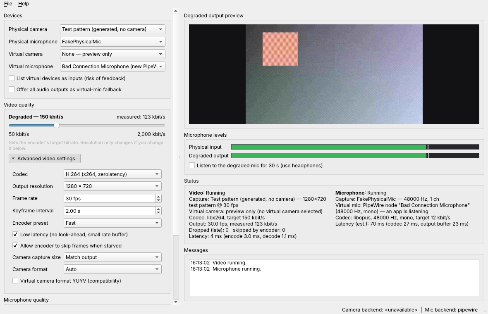

# Bad Connection Studio

Make your webcam and microphone sound and look like a bad connection, for
real. Bad Connection Studio encodes your **live** camera and microphone at
a bitrate you choose, decodes them immediately, and publishes the degraded
result as a **virtual camera** and **virtual microphone** that any call app
can select. The artifacts are genuine codec artifacts: blocking, smearing,
frame skipping, narrowband robotic speech. They are not filters.

* C++20, Qt 6 Widgets, CMake, FFmpeg libraries (libavcodec/-format/-device/-util, libswscale, libswresample)
* Linux (Fedora 44 first): v4l2loopback camera, native PipeWire microphone
* Windows 10/11: Softcam DirectShow camera (separate signed component), virtual audio cable microphone
* **Separate builds:** a Linux AppImage per architecture and a Windows installer. There is no single cross-platform binary.



## Features

* Separate **Video quality** (50 – 2,000 kbit/s, default 150) and
  **Microphone quality** (6 – 64 kbit/s, Opus VoIP mode) sliders with
  tier labels ("Very degraded — 50 kbit/s"), plus the measured bitrate.
* Live changes: bitrate applied in place (x264) or by restarting only the
  codec. Capture and virtual devices keep running and no delay builds up.
* Advanced: codec (x264 / VP8 / OpenH264 / VP9 / MPEG-4 / MPEG-2 and Opus /
  Speex / AAC, whatever the bundled FFmpeg provides), output resolution, frame
  rate, keyframe interval, encoder preset, low-latency mode, frame skipping,
  camera capture size/format, mono/stereo, codec sample rate.
* Preview of the actual degraded output; input/output level meters; 30 s
  local monitoring (headphones).
* Status: capture device, virtual device, codec, target/measured bitrate,
  fps/sample rate, dropped/skipped frames, measured (video) / estimated
  (audio) latency.
* Launch-time capability check and Diagnostics with setup instructions. A
  missing driver means preview-only mode with an explanation, never a crash.
* Hot-plug (camera and mic reconnect automatically), sleep/resume, clean
  shutdown with a "video paused" frame on the virtual camera.
* Feedback protection: virtual devices are hidden from the input lists by
  default, and the virtual mic is never the default source.
* Preferences are saved; camera/microphone content is never stored. Text-only
  logs in `~/.local/share/BadConnectionStudio/logs` (`%LOCALAPPDATA%` on Windows).

## OS-level prerequisites (not bundled)

| | Linux | Windows |
|---|---|---|
| Virtual camera | `v4l2loopback` kernel module (RPM Fusion on Fedora) | "Bad Connection Studio Virtual Camera" component (signed Softcam DLL, separate installer) |
| Virtual microphone | PipeWire session (default on Fedora); PulseAudio null-sink fallback | VB-Audio Virtual Cable (user-installed) |

See [docs/LINUX_SETUP.md](docs/LINUX_SETUP.md) and
[docs/WINDOWS_SETUP.md](docs/WINDOWS_SETUP.md) (including the investigation of
Windows mechanisms).

## Building

Linux (Fedora 44):

```bash
sudo dnf install cmake ninja-build gcc-c++ qt6-qtbase-devel qt6-qtmultimedia-devel \
  libavcodec-free-devel libavformat-free-devel libavdevice-free-devel libavutil-free-devel \
  libswscale-free-devel libswresample-free-devel pipewire-devel
cmake -S . -B build -G Ninja -DCMAKE_BUILD_TYPE=RelWithDebInfo
cmake --build build
ctest --test-dir build --output-on-failure
./build/src/bad-connection-studio
```

(Debian/Ubuntu: `qt6-base-dev qt6-multimedia-dev libavcodec-dev libavformat-dev
libavdevice-dev libavutil-dev libswscale-dev libswresample-dev libpipewire-0.3-dev`.)

AppImage: `packaging/linux/build-appimage.sh dist/`. It uses linuxdeploy and
its Qt plugin, and refuses to bundle libpipewire or a non-redistributable
FFmpeg.

Windows (MSYS2 UCRT64): see `.github/workflows/windows.yml`. In short:
`cmake -G Ninja`, `cmake --build`, then `cpack -G NSIS` in the build directory.

Useful extras:

* `bad-connection-studio --self-test`: headless codec + capability report (used by CI on clean machines)
* `bcs-roundtrip-bench`: milestone-1 prototype. It sweeps bitrates on synthetic material,
  `--camera /dev/video0` measures a real camera round-trip, and `--pipewire-mic` publishes
  degraded test speech on the PipeWire virtual microphone

## Repository layout

```
src/core/        codec round-trips, capture, pipelines, buffers (shared)
src/backend/     VirtualCameraBackend / VirtualMicBackend + linux/, windows/, common/
src/ui/          Qt Widgets UI, diagnostics
src/app/         logging, settings, power events
tests/           CTest executables (no framework needed)
tools/           roundtrip benchmark (milestone 1)
packaging/       AppImage script, desktop/metainfo, CPack NSIS, virtual-camera component installer
scripts/         dependency/license report generators
docs/            setup, architecture, licenses, testing
```

See [docs/ARCHITECTURE.md](docs/ARCHITECTURE.md) for threads, queues and
failure handling.

## Milestone status

| # | Milestone | Status |
|---|---|---|
| 1 | Codec round-trip prototype, latency measured | **Done.** 720p x264 round-trip 3–6 ms/frame; Opus codec delay 26.5 ms (see docs/TESTING.md) |
| 2 | Qt UI and live quality sliders | **Done**, verified offscreen with the test pattern |
| 3 | Linux camera output + PipeWire microphone | **Done.** PipeWire node verified against a real daemon; v4l2loopback output written to the kernel API but **not yet run against the module** |
| 4 | Fedora 44 package test + driver docs | Docs done; AppImage build + clean-container tests in CI; **needs a run on real Fedora 44 hardware** |
| 5 | Windows virtual camera/mic + installer | Mechanism chosen and implemented (Softcam + virtual cable), installer and signed-component pipeline written; **not yet compiled or run on Windows** |
| 6 | Hot-plug, errors, diagnostics, packaging, CI | Implemented; hardware hot-plug and sleep/resume need manual verification |
| 7 | Call-app matrix | Checklist in docs/TESTING.md; to be run |

## Licensing

The source code is MIT-licensed (see [LICENSE](LICENSE)). Bundled
third-party components keep their own licenses; see
[docs/LICENSES.md](docs/LICENSES.md). Each package includes a generated
`LICENSE-REPORT.txt`. Whether a binary package as a whole is LGPL or GPL
depends on the bundled FFmpeg's configuration.
